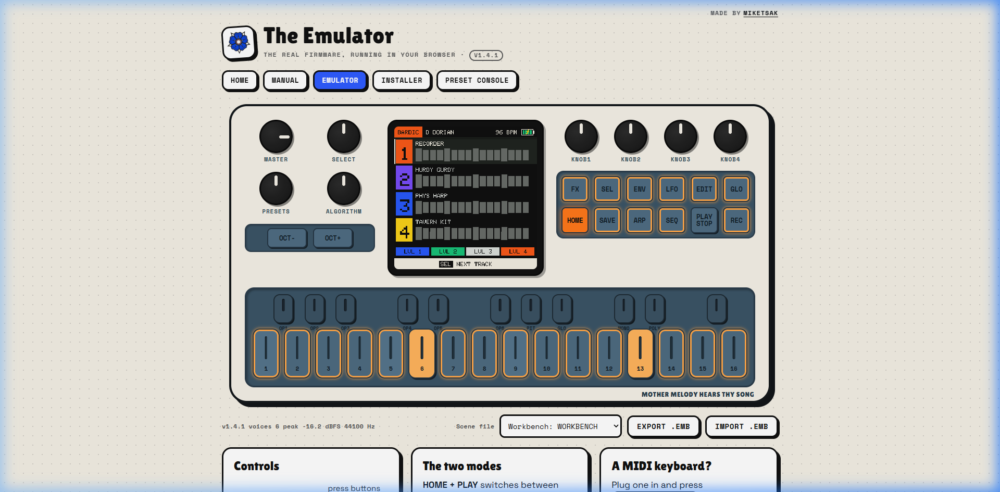
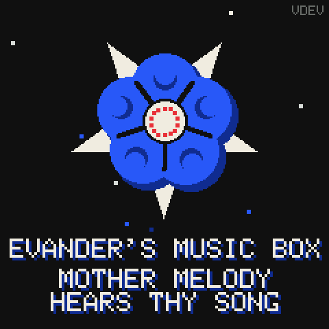
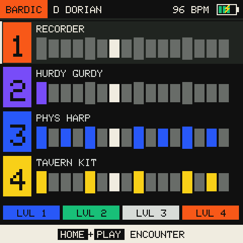
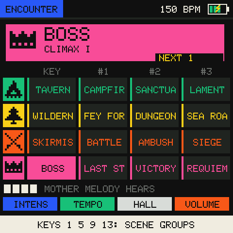
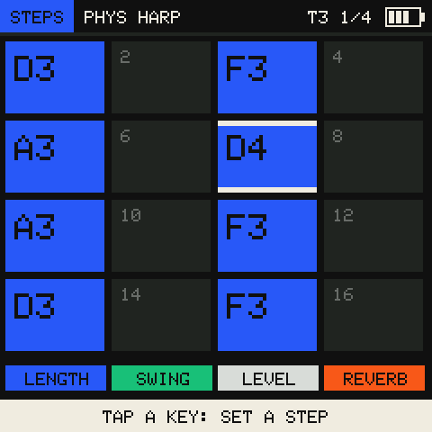

<p align="center">
  <br>
  <b>v1.4.1</b>
</p>

<h1 align="center">Evander's Music Box</h1>
<p align="center"><b>LARP-First Firmware for the M-VAVE (Cuvave) FM-1</b><br>
<i>Medieval & High-Fantasy Bard Synthesizer · "Mother Melody hears thy song"</i></p>

<p align="center">
  <b><a href="https://fm1.miketsak.gr/emu/">Emulator</a></b> &nbsp;·&nbsp;
  <b><a href="https://fm1.miketsak.gr/installer.html">Web Installer</a></b> &nbsp;·&nbsp;
  <b><a href="https://fm1.miketsak.gr/manual.html">Manual</a></b> &nbsp;·&nbsp;
  <b><a href="https://fm1.miketsak.gr/console.html">Console</a></b> &nbsp;·&nbsp;
  <b><a href="https://fm1.miketsak.gr/">Page</a></b>
</p>

<p align="center">
  
  
  <a href="LICENSE"></a>
  <a href="https://miketsak.gr"></a>
</p>

---

## Screenshots

<p align="center">
  <br>
  <i>The Web Emulator running the real C firmware in-browser with live hardware controls, active LED feedback, and multi-button latching.</i>
</p>

<p align="center">
  
  &nbsp;&nbsp;
  
  &nbsp;&nbsp;
  
  &nbsp;&nbsp;
  
</p>
<p align="center">
  <i>Left to right: Mother Melody sacred boot splash; 4-track Bardic Crafting deck; Encounter 16-scene matrix; 64-step sequencer.</i>
</p>

---

## Overview: LARP-First Firmware

**Evander's Music Box** is custom, open-source firmware designed from the ground up for **medieval and high-fantasy Live Action Roleplay (LARP)** on the pocket-sized **M-VAVE (Cuvave) FM-1** synthesizer.

Most synthesizers belong on a studio desk or a stage stand. Evander's Box was forged for the mud, costumes, leather armor, and campfires of live roleplay. It turns your FM-1 into the sacred relic of Evander, Elven Bard of Mother Melody. By day it scores live skirmishes and boss battles strapped directly to your forearm or bracers; by night around the tavern fire it is a four-track acoustic composition workshop.

There are **zero modern synth bleeps or electronic sweeps**. Every voice is an authentic acoustic physical model tuned for historical and fantasy settings: hurdy-gurdy with buzzing trompette, physical harps, lutes, psaltery, shawms, bagpipes, cathedral choirs, and bodhrán war drums.

It features two distinct operational modes:

- **Bardic Crafting.** A four-track medieval workshop: war drums, drones, plucked strings and winds. It has a
  64-step sequencer with microtiming and parameter locks, live looping, modal scales and historical
  temperaments.
- **Encounter.** For live roleplay, with the unit strapped to the forearm. Four lit keys are the four scene
  groups (rest, explore, combat, climax). The sharps after each group key play its variations, so there are
  sixteen soundtracks, from tavern to boss fight. A scene changes on the next bar with a crossfade. The other
  white keys bend the battle: Phrygian dread, a key change, half time, a breakdown, a stinger.

The same C core runs on the FM-1, compiled to WebAssembly in the browser emulator, and natively in a host
self-test.

> **Status: early hardware testing.** The core, the emulator and the web tools are built and tested (see
> [Testing](#testing)). On a real FM-1, v1.0 was found to stay dark when started on battery, to skip its boot
> animation, and to play far too quietly. The current code fixes the last two and hardens the battery start-up
> (see [Boot and power](#boot-and-power)). The battery fix has **not yet been confirmed on a unit**. Keep the
> recovery steps below close, and please report back what the boot screen's bottom line says.

---

## Feature matrix

| | Bardic Crafting | Encounter |
| --- | --- | --- |
| **Keys** | play the selected track, snapped to the mode | white 1 · 5 · 9 · 13: the scene groups · the sharps after each: its variations II-IV (hold the group key: IV) · the other whites: 12 battle modifiers |
| **Tracks** | 1 drums · 2 drone · 3 strings · 4 lead, any instrument on 2-4 | each scene is a four-track song |
| **Sequencer** | 64 steps, 4 notes a step, microtiming ±½ step, TONE p-locks, swing, live record (REC) | plays the scenes |
| **Timing** | free | changes quantized to beat / bar / 2 bars / 4 bars, crossfade 0-8 beats |
| **Control** | pages: SANCTUARY, ENVELOPE, MOTION, VOICE, MODES, STEPS | K1 intensity · K2 tempo · K3 hall · K4 music level |
| **Safety** | HOME + REC (hold 0.4 s): purge the loop, undoable | HOME + REC (hold): silence |
| **Switch** | **HOME + PLAY**: either way, the music never stops | |

**Instruments (20):** TAVERN / WAR / RITUAL drum kits, each with bodhrán, frame drum, tambourine, anvil,
timpani (tuned), war drum, clack and gong · PHYS HARP, LUTE, NYLON GTR, KOTO, PSALTERY (Karplus-Strong strings
with three sympathetic strings per track) · CHOIR, HURDY GURDY (with a trompette buzzing on the "coup" eighths),
BAGPIPE, LOW CELLO · PAN FLUTE, RECORDER, SHAWM, WAR BRASS (breath noise, chiff, reed saturation) · ORGANETTO,
POSITIVE, CATHEDRAL pipe organs, and the modern **TONEWHEEL** organ with four drawbar groups and a **Leslie**
rotor that spins up and slows down (EDIT + GLO).

Every voice has details taken from the real instrument:

| Instrument | Detail |
| --- | --- |
| plucked strings | the click of a quill plectrum, and two body resonances for each instrument's box or soundboard |
| choir | three singers and three formants |
| hurdy-gurdy | rosin scratch on every turn of the wheel |
| bagpipe | a grace-note skirl into each note |
| shawm | a hard double reed with two nasal formants |
| recorder, pan flute | breath scooping up into the pitch |
| small organs | bellows that never blow quite steady |
| cathedral organ | mixture ranks that beat gently against each other |

There are **no environmental sound effects** (fire, wind, nature). The box is played in real forests and around
real campfires, so their DSP time went to the instruments instead.

**SANCTUARY reverb:** pre-delay, four allpass diffusers and a 4-line Hadamard feedback network with damping and
slow modulation. RT60 runs from 0.5 s to about 12 s, with a "cathedral swell" one button away in Encounter.

**Loud enough for outdoors.** The master bus applies MASTER as makeup gain (up to +9.5 dB), then a peak limiter
with 0.73 ms of look-ahead. Peaks are turned down smoothly instead of squared off. The limiter's ceiling is the
**OUTPUT** setting:

| OUTPUT | Ceiling |
| --- | --- |
| LOUD (default) | −0.5 dBFS |
| NORMAL | −3 dBFS |
| SAFE | −6 dBFS, Felucca's own level, for a speaker that crackles near full scale |

**Tuning:** eight modes (Ionian, Dorian, Phrygian, Lydian, Mixolydian, Aeolian, harmonic minor, Phrygian
dominant). Four temperaments relative to the root: equal, Pythagorean, quarter-comma meantone, 5-limit just.
New songs default to D Dorian, Pythagorean, with snapping on.

**Reactive LEDs:** scale notes glow, roots shine at half light, and out-of-scale keys stay dark. In Encounter
only the four group keys are lit while idle. PLAY pulses on the beat, a queued scene blinks, and active
modifiers light up. See [MANUAL.md](MANUAL.md#v-the-lights-in-the-dark).

**The screen:** flat bold colour blocks on ink, hard shadows, a pixel font and pixel-art sprites for the scene
groups. Every screen has these, and the volume card appears whenever MASTER is turned:

| Element | What it shows |
| --- | --- |
| battery icon | always shown; a bolt on USB power |
| knob strip | four chips in the knobs' own colours |
| tips footer | changes with what you're doing; key names are drawn as keycaps |
| volume card | appears when MASTER turns, and leaves a second after it stops |

**The web suite (`web/`):** an emulator of the whole firmware in an AudioWorklet, a WebMIDI installer for the
`.fwsc` package (resume after interruption, return to official V15), and a preset console (backup and restore,
`.emb` song files, remote scene cueing for a game master).

## Architecture

```
src/
  emb.h             the core's whole interface: types, controls, the platform hooks
  emb.c             unity build of the core (one compilation unit, as Felucca builds)
  emb_dsp.c         fixed-point voices, sympathetic strings, Leslie, SANCTUARY reverb
  emb_engine.c      two decks, clock, sequencer, microtiming, live loop, purge, modifiers, mixer, limiter
  emb_scenes.c      the 16 factory scenes (pattern strings) and instrument defaults
  emb_gfx.c         240x240 RGB565 drawing, 5x7 font, sprites, battery, the crest, the Blue Rose, the boot
  emb_ui.c          both modes, every shortcut, LEDs, screens, tips, volume card, persistence, MIDI, SysEx
  platform/fm1.c    the FM-1: boot, ISRs, I2S DMA, key matrix, LCD, flash, USB-MIDI, updates
  platform/wasm.c   the browser: exports for the AudioWorklet
  platform/host.c   self-test, WAV renderer, screenshots
upstream/felucca    git submodule, Felucca v1.6.1 (GPL-3.0-only): the FM-1 HAL, USB, OTA, update loader, packager
web/                emulator (emu/), installer, preset console, shared theme and protocol (embmidi.js)
tools/build.py      test | web | fw | all | wav | shots
```

**Hardware layer.** The AC791N's register map, the I2S codec bring-up, the 11×6 diode key matrix behind two
74HC595s, the ST7789 panel on SPI1, the SPI NOR driver that runs from RAM, and the USB device stack all come
from **Felucca** (Hügelton Instruments). None of that was guessed: the FM-1 port includes Felucca's `hal/` and
its `usb.c`, `lcd.c` and `ota.c` unchanged, as its own update loader does. It links against Felucca's linker
script (code executes in place from flash, with 72 KiB of RAM and a 360 KiB pool). It is packaged with
Felucca's `fm1pkg_make.py` and update loader, so the stock **M-UPGRADE** protocol works as before.

**Real-time path.** The ALNK0 interrupt fires every 128 frames (2.9 ms at 44.1 kHz). It drains the command
ring, advances the clock in 24 ticks a step, runs up to 24 voices, the per-track inserts and the reverb, and
limits the master. It then writes the result into the half buffer that has just played, scaled to the codec's 24 bits. The main loop never touches audio state: it only
posts commands (`emb_post`), a single-writer ring. If a render runs past 80 % of its slot, the oldest voice is
shed. Everything is integer DSP with no FPU and no heap. Big buffers are static and go into the `.pool` RAM, and
a purge clears a track in place. On a desktop core the busiest scene renders at under 1 % of real time.

**Two decks.** Encounter changes are crossfades between two decks that share one voice pool. The queued scene
starts on the next quantize boundary, and the old deck fades over the crossfade length and then releases its
voices. Modifiers wait for the next beat. A modifier pressed while a scene is queued waits for that scene and
lands on it. Intensity (drone → +drums → +strings → full host) gates track gains with a 25 ms slew, so nothing
clicks.

### Boot and power

On battery the power switch raises every rail at once. The ST7789 panel ignores commands for up to 120 ms after
its supply comes up. Felucca reads its flash store before it first talks to the panel, but v1.0 talked to the
panel almost at once. That is the leading suspect for staying dark on battery but not on USB, though it is not
proven. A brownout as the amplifier and LEDs switch on is the other one. The boot now does the following:
1. waits 150 ms for power to settle
2. initialises the panel and draws the first frame before the codec, the amplifier and the LED sweep draw current
3. half a second in, re-sends the panel's wake-up commands (sleep-out, colour mode, display on) without a
   reset, so there's no visible flash, then redraws the whole screen

v1.0 also skipped its boot animation about half the time. Its clock started at `ms | 1`, which on an even
millisecond lies in the future, so the animation's length check wrapped around and ended it at once. That is
fixed.

If a run ends badly, the next boot screen names why on a pink line:

| Message | Meaning |
| --- | --- |
| `LAST RUN CRASHED` | the previous run crashed |
| `LAST BOOT STOPPED AT STEP n` | the previous boot halted at that step (1 start, 2 panel, 3 core, 4 audio, 5 USB, 6 interrupts, 7 first frame) |
| `LAST RESET: LOW VOLTAGE` | a brownout |
| `LAST RESET: WATCHDOG` | a hang |

**Persistence.** The settings, the workbench and the sixteen scenes take one 4 KiB flash sector each, in
Felucca's data area (`0x97000`, 18 sectors). A record is believed only if its magic and checksum agree, so
anything another firmware left there reads as empty and the factory scenes load.

## Flashing

You need **Chrome or Edge** on a desktop, a **data** USB-C cable, and a charged FM-1.

1. If you run another custom firmware, return to **official V15** first. The community advice is to use
   M-VAVE's updater, or the installer's *Return to official V15*.
2. Open the installer (`installer.html` on the project site, or `python3 tools/build.py all` and serve
   `build/web/`). Tick the box and press **Install**.
3. The FM-1 verifies the package, restarts into update mode (`ota-FM-1`), and the page writes the image.
   **Do not unplug.** If it stops, replug the cable and press Install again: the page finds the waiting
   loader and **resumes**.
4. The box restarts with the crest and the rose. The package identity is `FM-1_777`.

From a terminal, Felucca's installer works too:
`pip install mido python-rtmidi && python3 upstream/felucca/tools/fm1_install.py build/fw/emb.fwsc`.

### Recovery

- **The firmware runs but misbehaves:** use the installer again, or *Return to official V15*.
- **Hold OCT- + OCT+ for 5 s** (while running), or send SysEx `F0 22 24 35 7D F7`. Either one enters the
  chip's own update mode, **WL82 UBOOT** (USB `4C4A:8057`), where `jl-uboot-tool` and the community unbrickers
  work.
- **Power on while holding OCT-**, or crash at boot repeatedly: the chip's own ROM may enter UBOOT. That
  presents a USB disk, not MIDI, so the web installer cannot see it. Use the unbricker tools (see
  `Learn dark screen.md` for the Windows 11 fixes).
- **Hard brick:** the RP2040 *FM-1 Transporter* dongle reads and writes the flash over the JieLi USB key. See
  the [community hub](https://github.com/aroum/fm1-custom-fw). The boot head below `0x4000` is never written by
  this firmware or its installer.

## Building and testing

See [BUILDING.md](BUILDING.md). In short:

```sh
git clone --recurse-submodules <this repo>
pip install ziglang                 # or use any clang / gcc
python3 tools/build.py test         # the host self-test
python3 tools/build.py web          # the emulator and tools: build/web/
python3 tools/build.py fw           # the FM-1 package (JieLi pi32v2 toolchain + AC79 SDK)
```

### Testing

`tools/build.py test` builds `src/platform/host.c` and checks the following:
- the fixed-point math: pitch to within 0.05 %, octaves, the divider, decay times, and the temperament tables
- scale snapping and modal remapping
- that all 16 scenes are valid, sound, and stay off the rail
- a bar-quantized crossfade that lands on step 0 and fades out the old scene
- microtiming to sample accuracy
- purge and undo
- the mode chord in both press orders, and that it does not start the transport
- the step editor, the organ toggle, and every page drawing
- the SysEx protocol round trip and factory restore
- the boot animation's full length after an even first tick
- the Encounter key map: every scene reachable, no key doubled, a held group key cueing variation IV, and a
  modifier landing on the scene it waited for
- the volume card: it shows on a turn, ignores pot jitter, and leaves a second later
- the limiter: at full MASTER on the loudest scene, no sample passes the ceiling

Every melodic instrument was measured in tune (≤ 2 cents; the cathedral and tonewheel organs also sound their
16′ rank, an octave down, as real ones do). Each was level-matched to −14 dBFS, averaged over four notes. The web
pages were checked in Chrome: the emulator plays its boot animation, switches mode, and cues a scene. It also
shows the volume card when MASTER is turned. The installer and console load. `tools/build.py wav 13 30` renders
the boss fight to a WAV, and `tools/build.py shots` writes screenshots.

## Credits and licence

**GPL-3.0-only** (see [LICENSE](LICENSE)). Copyright (C) 2026 Michail Tsakiroglou &lt;https://miketsak.gr&gt;.

- **[Michail Tsakiroglou](https://miketsak.gr)**: Concept, firmware architecture, C DSP audio engine, physical modelling instruments, SANCTUARY reverb, graphics & boot animation, WebAssembly emulator, WebMIDI tooling, and site design.
- **[Felucca](https://github.com/hugelton/Felucca)** by Leo Kuroshita / Hügelton Instruments: the FM-1
  hardware layer, USB-MIDI, the M-UPGRADE protocol and update loader, the package format, and the web update
  library (`web/vendor/` in the built site). GPL-3.0-only.
- **[GHOULBOX](https://github.com/jasonpersinger/ghoulbox-fm1-dungeon-synth)** by Jason Persinger: the
  inspiration for the cathedral HALL, the hurdy-gurdy's crank and trompette, and the historical temperaments.
  No code is copied.
- **[aroum/fm1-custom-fw](https://github.com/aroum/fm1-custom-fw)**: the community's reverse-engineering notes
  on the SysEx OTA handshake, the flash layout, and recovery.
- Fonts on the web pages: Lilita One, Space Grotesk and Space Mono (SIL OFL), served by Google Fonts.

Not affiliated with M-VAVE, Cuvave or JieLi. This is hobby firmware, flashed at your own risk.
